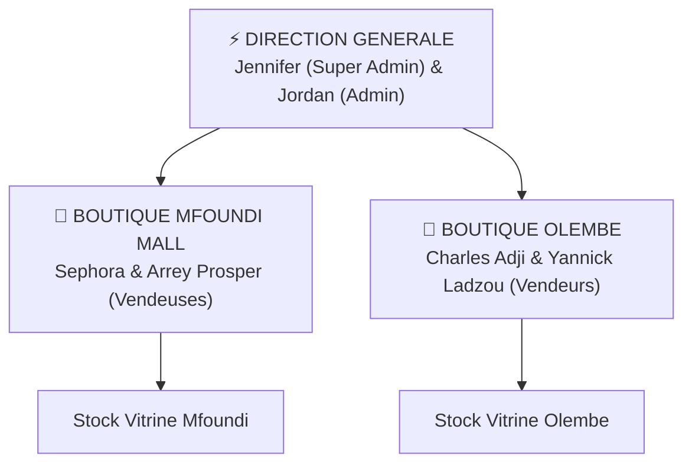
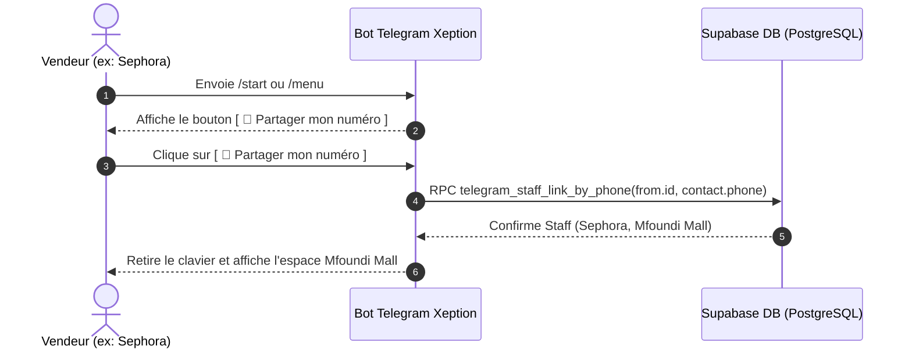
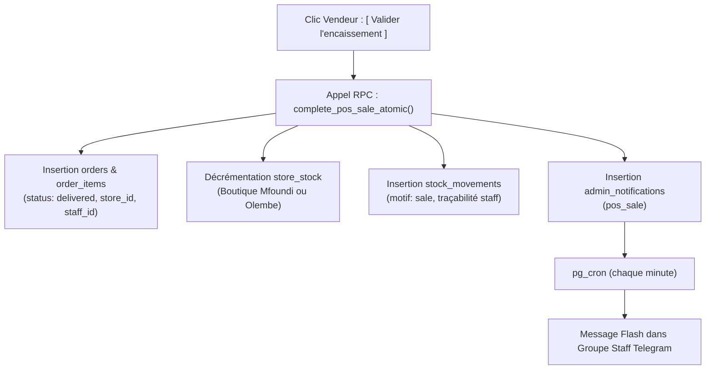

# Plan d'Architecture & Opérations : Bot Telegram Staff Xeption

> **Auteur** : Antigravity & Équipe Xeption  
> **Date** : 20 Octobre 2026  
> **Statut** : 
> - ✅ **Phase 1 (En production)** : Authentification Telegram, liaison staff sécurisée, navigation tactile stocks & Smart Troc, alertes groupe.
> - ✅ **Phase 2 (En production)** : Gestion RH (activation/désactivation, objectifs de vente) & demandes d'activation vendeurs.
> - 📋 **Phase 3 (Spécification / Cadrage)** : Tunnel de vente comptoir atomique, facture PDF et reçu WhatsApp (soumis à validation préalable architecte).
> **Cible** : Direction Xeption & Équipes Boutiques (Mfoundi Mall & Olembe)

---

## 1. Vision & Objectifs Métier

Le bot Telegram **Xeption Staff** transforme la gestion quotidienne de la boutique en une console mobile tactile, rapide et utilisable **100% au pouce** sur smartphone debout au comptoir.

### Principes directeurs :
1. **Zéro syntaxe textuelle à mémoriser** : Le vendeur ne tape aucune commande technique. Tout le parcours s'effectue par des boutons tactiles interactifs (`Inline Keyboard`).
2. **Navigation bidirectionnelle (Avancer / Reculer)** : Chaque écran propose systématiquement un bouton `[ ⬅️ Précédent ]` et un bouton `[ 🏠 Accueil ]` pour ne jamais bloquer le vendeur.
3. **Vérité ERP instantanée** : Chaque action (vente, troc, stock) met à jour la base de données PostgreSQL de l'ERP en temps réel (`orders`, `store_stock`, `stock_movements`).
4. **Visibilité collective** : Chaque vente ou troc validé déclenche une notification flash dans le groupe Telegram officiel de l'équipe.
5. **Délivrance client immédiate** : Génération du reçu de garantie WhatsApp en 1 clic et facture officielle web/PDF.

---

## 2. Cartographie de l'Équipe & Rôles (RBAC par Boutique)

L'équipe est composée de **6 personnes** réparties sur deux points de vente physiques et la direction générale :



| Rôle / Poste | Affectation | Profil ERP | Accès bot Telegram |
| :--- | :--- | :--- | :--- |
| **Direction (Super Admin)** | Siège / Direction | Compte `super_admin` | Vue globale multi-boutiques, CA consolidé, alertes, modération |
| **Direction (Admin)** | Siège / Direction | Compte `direction` | Vue globale multi-boutiques, validation trocs, supervision |
| **Vendeuse 1** | Boutique Mfoundi Mall | Compte `vendeur` | Caisse & stock Mfoundi, consultation trocs |
| **Vendeuse 2** | Boutique Mfoundi Mall | Compte `vendeur` | Caisse & stock Mfoundi, consultation trocs |
| **Vendeur 1** | Boutique Olembe | Compte `vendeur` | Caisse & stock Olembe, consultation trocs |
| **Vendeur 2** | Boutique Olembe | Compte `vendeur` | Caisse & stock Olembe, consultation trocs |

> 🔒 *Sécurité & Confidentialité : Les numéros de téléphone ne sont pas stockés dans ce fichier versionné. La table `public.staff` en base de données sécurisée constitue l'unique source de vérité.*

---

## 3. Authentification Instantanée sans Mot de Passe

Pour éviter les mots de passe oubliés sur smartphone en boutique, l'authentification repose sur le numéro certifié de Telegram :



* **Fonction DB** : `public.telegram_staff_link_by_phone(p_telegram_user_id text, p_phone text)` (migration `20261020_009_telegram_link_by_phone.sql`). L'ancienne `bind_staff_by_phone` est désactivée (`20261020_011`) : ne plus l'utiliser.
* **Vendeur sans compte** : demande d'activation (`telegram_staff_activation_requests`) validée ✅/❌ par la direction (`telegram_staff_activation_decide`), aussi depuis 👥 Gestion RH.
* **Sécurité** : `contact.user_id === from.id` vérifié pour garantir que l'utilisateur partage bien son propre numéro certifié par Telegram.

---

## 4. Parcours Utilisateur & Ergonomie Tactile

### 4.1 Vue Accueil Vendeur (ex: Sephora au Mfoundi Mall)
```text
🏪 Mfoundi Mall
Bonjour Sephora 👋
Que souhaitez-vous faire ?

[ 📦 Stocks & Prix ]       [ 🔄 Smart Troc ]
[ 🛒 Enregistrer Vente ]   [ 📊 Ventes du Jour ]
[ ⚠️ Stocks Faibles ]      [ 📲 Ouvrir Xeption App ]
```

### 4.2 Vue Accueil Direction (Jennifer / Jordan)
```text
⚡ XEPTION | Console Direction
Bonjour Jennifer (Super Admin)

[ 🏪 Mfoundi Mall ]       [ 🏪 Olembe ]
[ 📦 Stocks Globaux ]     [ 🔄 Dossiers Trocs ]
[ 💰 Bilan CA Global ]     [ ⚠️ Alertes Ruptures ]
[ 📲 Ouvrir Xeption App ]
```

### 4.3 Recherche Express Tolérante aux Fautes de Frappe (Fuzzy Search)
Pour aller encore plus vite qu'en parcourant les catégories au pouce :
* Le vendeur écrit directement la marque ou le modèle dans la discussion (ex: `radmi`, `15c`, `a3 pro`, `iphne 13`, `samsng`, `pixel 6`).
* **Tolérance aux fautes d'orthographe** : L'algorithme combine le substring match, la similarité trigramme (`pg_trgm`) et la distance de Levenshtein (tolérance de 2 à 3 caractères).
* **Résultats interactifs** : Le bot répond instantanément avec les modèles correspondants sous forme de boutons tactiles :
```text
🔍 Résultats pour « radmi » — Toutes boutiques

Sélectionnez un modèle pour voir son stock, son prix ou vendre :

[ Xiaomi Redmi 15C (100 dispo) ]
[ Xiaomi Redmi A3 Pro 128 Go (100 dispo) ]
[ Xiaomi Redmi A5 (100 dispo) ]
[ Xiaomi redmi 9 activ (12 dispo) ]
[ Xiaomi Redmi 15 (12 dispo) ]
[ Xiaomi Redmi 14C 256 Go (10 dispo) ]

[ 📦 Voir Catégories ]   [ 🏠 Accueil ]
```
* **Un clic pour agir** : Taper sur n'importe quel bouton ouvre la fiche du modèle avec stock boutique, prix et le bouton `[ 🛒 Vendre ce produit ]`.
* **Fonction DB** : `public.telegram_search_products_fuzzy(p_query, p_store_code, p_telegram_user_id, p_limit)` (migration `20261021_002_telegram_search_products_fuzzy.sql`).


---

## 5. Tunnel de Vente Comptoir (Spécification Cible — En attente de validation architecte)

> ⚠️ **Note de cadrage** : Ce tunnel de vente au comptoir (les 6 scénarios ci-dessous, l'encaissement via `complete_pos_sale_atomic()`, le reçu WhatsApp et la facture PDF) représente la proposition d'architecture cible. Il fera l'objet d'une validation préalable avec l'architecte avant tout développement.

### Scénario 1 : Vente Standard (Espèces ou Mobile Money)
* Le client paie le prix affiché.
* Le vendeur sélectionne le produit -> `[ 🛒 Vendre ce produit ]` -> Choix du moyen : `[ 💵 Espèces ]` / `[ 🟠 Orange Money ]` / `[ 🟡 MTN MoMo ]`.
* Saisie rapide du prénom et numéro WhatsApp client (pour la garantie).

### Scénario 2 : Négociation & Remise au comptoir
* Le client négocie le prix (ex: 300 000 F au lieu de 310 000 F).
* Le bot propose des boutons de remise rapide :
  * `[ Prix standard : 310k ]`
  * `[ 🏷️ Remise -5 000 F (305k) ]`
  * `[ 🏷️ Remise -10 000 F (300k) ]`
* **Règle de gestion** : Remise vendeur plafonnée à 10 000 FCFA. Au-delà, une demande de validation push est transmise à Jordan/Jennifer sur Telegram.

### Scénario 3 : Paiement Mixte / Fractionné
* Le client paie une partie en cash et le reste par Mobile Money (ex: 200k cash + 100k MoMo).
* Le vendeur sélectionne `[ 🔀 Paiement Mixte ]` et indique la ventilation.
* Permet un arrêté de caisse parfait le soir (total liquide vs total comptes marchands).

### Scénario 4 : Vente avec Reprise (Smart Troc)
* Le client échange un ancien appareil estimé à 85 000 F contre un modèle neuf à 310 000 F.
* Le vendeur sélectionne `[ 🔄 Vente avec Troc ]` et choisit le dossier validé.
* Le bot déduit automatiquement l'estimation :
  $$\text{Reste à encaisser (Soulte)} = 310\,000 - 85\,000 = 225\,000\text{ FCFA}$$
* Le vendeur n'encaisse que 225 000 FCFA. L'ancien modèle intègre le stock troc/reprise.
* *(Pas de contre-offre, conformément à la consigne : validation directe ou refus)*.

### Scénario 5 : Vente Groupée avec Accessoires (Cross-Selling)
* Avant validation, boutons d'ajout express :
  * `[ ➕ Verre trempé (+3 000 F) ]`
  * `[ ➕ Chargeur rapide 20W (+15 000 F) ]`
  * `[ ➕ Coque de protection (+5 000 F) ]`
* Le tout est regroupé sur la même commande et la même facture.

### Scénario 6 : Réservation & Transfert avec Acompte
* Produit en rupture locale au Mfoundi mais disponible à Olembe.
* Le client verse un acompte (ex: 50 000 F).
* Le vendeur sélectionne `[ 🚚 Acompte & Transfert Olembe ]`.
* Une unité est réservée à Olembe et le livreur/coursier est notifié.

---

## 6. Synchronisation ERP en Temps Réel

Dès validation de la vente sur Telegram :



---

## 7. Diffusion des Alertes Groupe (Canal Telegram Staff)

Chaque vente validée génère une notification collective dans le groupe du personnel :

```text
🛍️ NOUVELLE VENTE BOUTIQUE
📱 iPhone 13 128Go (Bleu)
▫️ Montant : 300 000 FCFA (Orange Money)
▫️ Remise accordée : -10 000 FCFA
▫️ Boutique : Mfoundi Mall
▫️ Vendeuse : Sephora
▫️ Client : Samuel K. (+237 670...)
▫️ N° Commande : CMD-POS-8421
```

---

## 8. Facturation & Reçus Clients

### 8.1 Reçu WhatsApp en 1 clic
Le bot affiche un bouton direct au vendeur :  
👉 **`[ 📲 Envoyer reçu WhatsApp au client ]`**

Format généré et pré-rempli :
```text
🧾 REÇU D'ACHAT & GARANTIE XEPTION
N° Commande : CMD-POS-8421
Date : 20/10/2026 à 14h25
Boutique : Mfoundi Mall — Vendeuse : Sephora

Article : iPhone 13 128Go Bleu
Montant réglé : 300 000 FCFA (Orange Money)
Garantie : 6 mois (Xeption Certified)
IMEI : 358921098421098

Consultez votre facture officielle en ligne :
https://www.xeptionetwork.shop/facture/CMD-POS-8421
```

### 8.2 Facture Web & PDF
* Hébergée automatiquement sur le domaine officiel `xeptionetwork.shop`.
* Inclut le logo Xeption officiel, le QR code de vérification d'authenticité et les mentions de garantie.
* Transmission automatique par email si le client a laissé son adresse.

---

## 9. Synthèse Technique & Fichiers Clés

| Composant | Rôle | Emplacement |
| :--- | :--- | :--- |
| **Edge Function Bot** | Routeur webhook, écrans tactiles et boutons Telegram | `supabase/functions/telegram-bot-entry/index.ts` |
| **Liaison Staff** | Contact Telegram → `telegram_staff_links` (seule source d'identité) | `supabase/migrations/20261020_009_telegram_link_by_phone.sql` |
| **Activation vendeur** | Demande + décision direction | `supabase/migrations/20261020_012_telegram_staff_activation_requests.sql` |
| **Gestion RH** | Staff par boutique, (dés)activation, objectifs | `supabase/migrations/20261020_015_telegram_staff_hr.sql` |
| **Encaissement Atomique** | Procédure stockée de vente caisse | `public.complete_pos_sale_atomic()` |
| **Relais Notifications** | Distribution cron vers groupe Telegram | `supabase/functions/notify-staff/index.ts` |
| **Mini App Web** | Application compagnon, servie sur `https://www.xeptionetwork.shop/staff` | API : `supabase/functions/telegram-miniapp-api/index.ts` |
